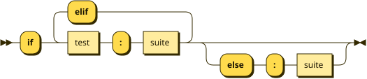
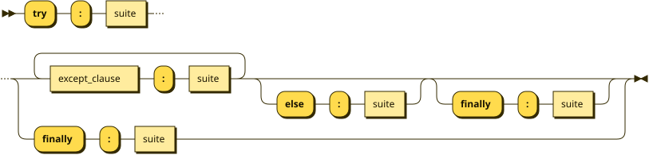

# RR - Railroad Diagram Generator

RR is a generator of syntax diagrams, also known as railroad diagrams. It is
a self-contained tool with both a browser-based GUI and a batch mode.

Besides generating diagrams from EBNF rules, RR also can perform some grammar transformation, e.g. factorization
and elimination of direct recursion. To some extent this transforms BNF to EBNF, yielding more compact diagrams.

# Examples

Here are two examples of generated diagrams (taken from the [Python grammar][PYTHON]):

**if_stmt:**



**try_stmt:**



# Grammar syntax

RR accepts grammars in [W3C-style EBNF][W3C-EBNF]. Some other representations, including
some parser generator input notations, can be converted to W3C-style using
the [ebnf-convert][CONVERT] Grammar Converter. This tool
is also available [on GitHub][CONVERT-GITHUB].

# Distribution

RR comes as a .zip, containing a .war file. The .war file can be deployed
in Jakarta EE servlet containers like Tomcat 10.1 (or higher) or Jetty 12 for serving the GUI.
This makes up the webapp that is running on the original website, <https://www.bottlecaps.de/rr/ui>.
Older containers using the `javax.servlet` namespace, such as Tomcat 9 or earlier, are not supported.

Running RR requires Java 17 or higher.

The .war file is a Java "executable war", i.e. it can also be started
standalone from command line. Two different tasks can be performed in standalone mode:

- serving the GUI, e.g.

```bash
   java -jar rr.war -gui
```
- batch diagram generation, e.g.

```bash
   java -jar rr.war grammar.ebnf
```

For listing the full set of available options, run

```bash
   java -jar rr.war
```
without further command line arguments.

# Light and dark mode

Diagrams and the GUI can be created in light mode, in dark mode, or in auto mode, which
follows the color scheme of the operating system or browser:

- In the GUI, the mode can be selected on the Options tab. It defaults to auto.
- In batch mode, the mode is selected by command line option `-mode:auto`, `-mode:light`
  or `-mode:dark`. It defaults to light. When using the
  API, the same is done by `RailroadGenerator.setMode`.

Some things to be aware of:

- In auto mode, the output contains CSS media queries (`prefers-color-scheme`), that switch the colors. An SVG
  graphic that is displayed on its own follows the color scheme of the operating system or browser. When it is
  displayed from an `` element, like Markdown viewers do, the page cannot pass its own theme on to the
  image: a viewer that colors itself according to its own theme, such as the Markdown preview of VS Code, still
  shows the image in the color scheme of the operating system or browser. Some browsers may take the
  `color-scheme` of the embedding page into account, but this should not be relied upon. If you need the diagrams
  to follow a theme setting, create light and dark graphics separately, and select them there, e.g. by a
  `<picture>` element.
- PNG graphics cannot do this, so auto mode is not supported for them. In batch mode, `-png` together with
  `-mode:auto` is rejected. In the GUI, when PNG is selected for download while the mode is auto, the
  Download panel asks for light or dark colors, preselected by the current color scheme of the browser.
  PNG graphics have a transparent background in all modes, so dark mode PNGs are best shown on a dark background.

# Building RR
For building RR, JDK 17 (or higher) must be available. In the
project folder, run this command to build the distribution .zip file:

```bash
gradlew
```

# RR on Maven Central

RR is available on Maven Central with groupId `de.bottlecaps.rr` and artifactIds

 -  [`rr-webapp`][rr-webapp] for `rr.war`,
 -  [`rr-lib`][rr-lib] for `rr.jar`, which can be added to other projects as a dependency.

# Thanks

This project makes use of
  * [Saxon-HE][SAXON],
  * [TagSoup][TAGSOUP],
  * [Apache Batik][BATIK],
  * [Ace Editor][ACE],
  * [Gradle][GRADLE], and
  * [Gradle-License-Report][GRADLE-LICENSE-REPORT].

# License

Copyright (c) 2010-2026 Gunther Rademacher. RR is provided under the [Apache 2 License][ASL].

# Links

The official website for RR is <https://www.bottlecaps.de/rr/ui>.

[ASL]: https://www.apache.org/licenses/LICENSE-2.0.txt
[PYTHON]: https://docs.python.org/3/reference/grammar.html
[W3C-EBNF]: https://www.w3.org/TR/2010/REC-xquery-20101214/Overview.html#EBNFNotation
[CONVERT]: https://www.bottlecaps.de/ebnf-convert/
[CONVERT-GITHUB]: https://github.com/GuntherRademacher/ebnf-convert
[SAXON]: https://www.saxonica.com/products/products.xml
[TAGSOUP]: https://central.sonatype.com/artifact/org.ccil.cowan.tagsoup/tagsoup/1.2.1
[BATIK]: https://xmlgraphics.apache.org/batik/
[ACE]: https://ace.c9.io/
[GRADLE]: https://gradle.org/
[GRADLE-LICENSE-REPORT]: https://github.com/jk1/Gradle-License-Report
[rr-webapp]: https://central.sonatype.com/artifact/de.bottlecaps.rr/rr-webapp
[rr-lib]: https://central.sonatype.com/artifact/de.bottlecaps.rr/rr-lib
